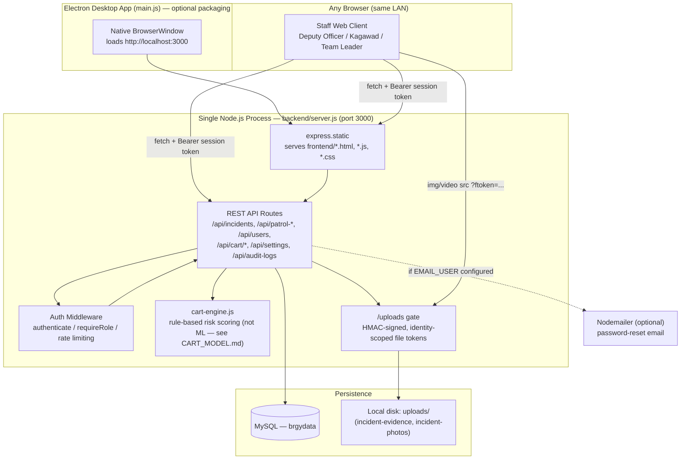

# System Architecture & Database Design

Reference diagrams for the thesis methodology chapter. Both are Mermaid diagrams —
GitHub renders them inline, and they can be exported to PNG/SVG via the
[Mermaid Live Editor](https://mermaid.live) (paste the code block, then Export) for
inclusion in the printed document.

The Data Flow Diagrams (Level 0 context and Level 1 decomposition, plus the data
dictionary) are in [`DFD.md`](DFD.md).

## 1. System Architecture

Barangay 179 Crime BI is a **single Node.js process** (`backend/server.js`) that both
serves the static frontend and exposes the REST API — there is no separate frontend
server, and no separate backend deployment. The Electron shell (`main.js`) is purely
an optional desktop wrapper: it starts that same Express process in-process and opens
a native window pointed at `http://localhost:3000`. Any device on the same LAN can
instead reach it directly from a browser.

**Key design points worth citing in the methodology chapter:**

- **One auth system for all users**: staff accounts (`users` table, session tokens in
  `user_sessions`) with a rate-limited lockout (`login_attempts`, 5 failed attempts per
  15 minutes) layered under a generic IP-based rate limiter on every auth route.
- **Role-based access control** (`requireRole([...])` middleware) gates every route by
  the staff roles (Deputy Officer, Kagawad, Team Leader).
- **File access is token-gated, not a bare static mount** — a 60-second HMAC-signed
  token (`issueFileToken`/`verifyFileToken`) is required on every `/uploads/*` request.
- **CART is a rule-based weighted scoring engine**, not a trained machine-learning
  model — see `docs/CART_MODEL.md` for the full rationale and `docs/FUTURE_WORK.md` for
  what training a real model against this would require.

## 2. Entity-Relationship Diagram

Generated directly from `database/schema.sql` (17 tables). Grouped by subsystem below
for readability, but this is one connected diagram — foreign keys cross the groups
(e.g. almost every table traces back to `users`).

```mermaid
erDiagram
    ARCHIVED_RECORDS {
        int id PK
        varchar entity_type "incident | incident_evidence | patrol_schedule | patrol_log | user"
        int entity_id
        varchar label
        json data "snapshot of the deleted row + related rows"
        json files "uploads moved to uploads/archive/"
        int deleted_by FK
        timestamp deleted_at
        int restored_by FK
        timestamp restored_at
    }

    USERS {
        int id PK
        varchar name
        varchar username UK
        varchar password_hash
        enum role "Deputy Officer | Kagawad | Team Leader"
        varchar contact_no
        varchar email
        tinyint is_active
        timestamp last_login_at
    }

    USER_SESSIONS {
        int id PK
        int user_id FK
        varchar session_token UK
        timestamp login_time
        timestamp last_activity
        timestamp logout_time
        varchar ip_address
        tinyint is_active
    }

    LOGIN_ATTEMPTS {
        int id PK
        varchar username
        varchar ip_address
        timestamp attempt_time
        tinyint success
    }

    LOGIN_HISTORY {
        int id PK
        int user_id FK
        varchar username
        varchar ip_address
        datetime login_time
    }

    PASSWORD_RESETS {
        int id PK
        int user_id FK
        varchar reset_token UK
        timestamp expires_at
        timestamp used_at
    }

    AUDIT_LOGS {
        int id PK
        int user_id FK
        varchar action
        varchar entity_type
        int entity_id
        json old_data
        json new_data
        varchar ip_address
        timestamp created_at
    }

    SYSTEM_SETTINGS {
        int id PK
        varchar setting_key UK
        text setting_value
        int updated_by FK
    }

    INCIDENTS {
        int id PK
        varchar incident_type
        date date
        time time
        decimal latitude
        decimal longitude
        varchar street_name
        varchar address
        int reporter_id FK "nullable — staff who logged it"
        varchar status "Open | Monitoring | Resolved"
        text description
        varchar danger_level
        varchar photo_path
        varchar blotter_number
        varchar reported_by_name "citizen/reporter, free text"
        varchar priority "Normal | Urgent"
    }

    INCIDENT_EVIDENCE {
        int id PK
        int incident_id FK
        varchar file_path
        enum file_type "image | video"
        varchar original_filename
    }

    CART_RISK_FACTORS {
        int id PK
        int incident_id FK "one row per incident, UNIQUE"
        decimal time_risk_score
        decimal day_risk_score
        decimal type_risk_score
        decimal location_risk_score
        decimal frequency_risk_score
        decimal total_risk_score
        varchar danger_level
        text decision_path
        varchar model_version
    }

    CART_ANALYSIS_LOG {
        int id PK
        varchar analysis_type "risk_prediction | simulation"
        date date_range_start
        date date_range_end
        int total_incidents_analyzed
        int high_risk_count
        int moderate_risk_count
        int low_risk_count
        int triggered_by FK
    }

    CART_DECISION_RULES {
        int id PK
        varchar rule_name
        text conditions
        varchar result_risk_level
        int created_by FK
        tinyint is_active
    }

    LOCATION_COORDINATES {
        varchar location PK
        decimal latitude
        decimal longitude
        int set_by FK
    }

    AREA_RISK_DECAY {
        varchar location PK
        decimal decay_amount
        timestamp updated_at
    }

    PATROL_SCHEDULES {
        int id PK
        varchar location
        time start_time
        time end_time
        varchar day_of_week
        text reason
        varchar status "Active | Completed"
        decimal latitude
        decimal longitude
    }

    PATROL_LOGS {
        int id PK
        int schedule_id FK
        text report
        varchar status "Completed | Partial"
        date patrol_date
    }

    %% ── User / Auth subsystem ──────────────────────────────────────
    %% A staff user owns many session tokens; each token belongs to exactly one user.
    USERS ||--o{ USER_SESSIONS : "user_id · 1 user → 0..* active sessions"
    %% Every successful login writes a history row; rows outlive the session.
    USERS ||--o{ LOGIN_HISTORY : "user_id · 1 user → 0..* login events"
    %% A user may request multiple resets over their lifetime.
    USERS ||--o{ PASSWORD_RESETS : "user_id · 1 user → 0..* OTP reset requests"
    %% Every state-changing API call appends an audit row attributed to the caller.
    USERS ||--o{ AUDIT_LOGS : "user_id · 1 user → 0..* audit entries"
    %% Each setting row records who last changed it (not the full history — audit_logs covers that).
    USERS ||--o{ SYSTEM_SETTINGS : "updated_by · 1 user → 0..* settings last touched"

    %% ── Incident reporting ───────────────────────────────────────
    %% Incidents carry the reporter's user_id (nullable).
    USERS ||--o{ INCIDENTS : "reporter_id · 1 user → 0..* staff-created incidents"
    %% Who clicked 'Run CART Analysis' in the dashboard.
    USERS ||--o{ CART_ANALYSIS_LOG : "triggered_by · 1 user → 0..* analysis runs"
    %% Decision rules are authored by admin users.
    USERS ||--o{ CART_DECISION_RULES : "created_by · 1 user → 0..* rule definitions"
    %% An admin pins a GPS coordinate for each street name.
    USERS ||--o{ LOCATION_COORDINATES : "set_by · 1 user → 0..* location pins"

    %% ── Archive ──────────────────────────────────────────────────
    %% deleted_by and restored_by are both nullable FKs to users on the same table.
    %% No FK constraint — the original row is gone when the archive row is written.
    USERS ||--o{ ARCHIVED_RECORDS : "deleted_by / restored_by · 1 user → 0..* archive events"

    %% ── Incident evidence & CART scoring ────────────────────────
    %% One incident can have many attached files (photos / videos).
    INCIDENTS ||--o{ INCIDENT_EVIDENCE : "incident_id · 1 incident → 0..* evidence files"
    %% CART scoring is run on-demand; a row is created only after the engine scores the incident.
    %% A new incident has no risk-factor row until CART analysis runs → zero-or-one, not exactly-one.
    INCIDENTS ||--o| CART_RISK_FACTORS : "incident_id (UNIQUE) · 1 incident → 0..1 CART score"

    %% ── Patrol scheduling (log) ──────────────────────────────────
    %% Each patrol log is filed against the schedule it covers.
    PATROL_SCHEDULES ||--o{ PATROL_LOGS : "schedule_id · 1 schedule → 0..* filed patrol logs"
```

`ARCHIVED_RECORDS` holds everything deleted anywhere in the app: `entity_type` +
`entity_id` point at the original table and row, but deliberately without a foreign
key, because the original row no longer exists (or, for users, is deactivated).
`data` keeps a full JSON snapshot so the Deputy Officer can restore it from
Settings > Archive (see `backend/archive.js`).

`LOGIN_ATTEMPTS` is intentionally not linked by foreign key — it keys off `username`
(text) specifically so a lockout record survives even
if the account is later deleted, and so a username can be rate-limited before the
system has even confirmed it belongs to a real account.

## Known gap

There is no `street_id` foreign key — `incidents.street_name`, `patrol_schedules.location`
and `location_coordinates.location` all key off the same free-text street name,
validated at the application layer against `backend/locationList.js` rather than a
proper lookup table. See `docs/FUTURE_WORK.md` for why this wasn't changed now.
