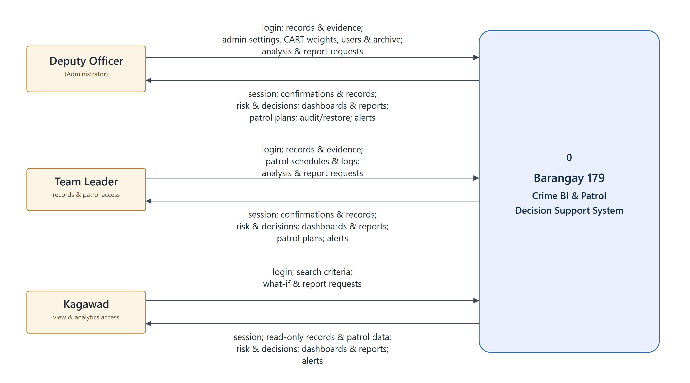
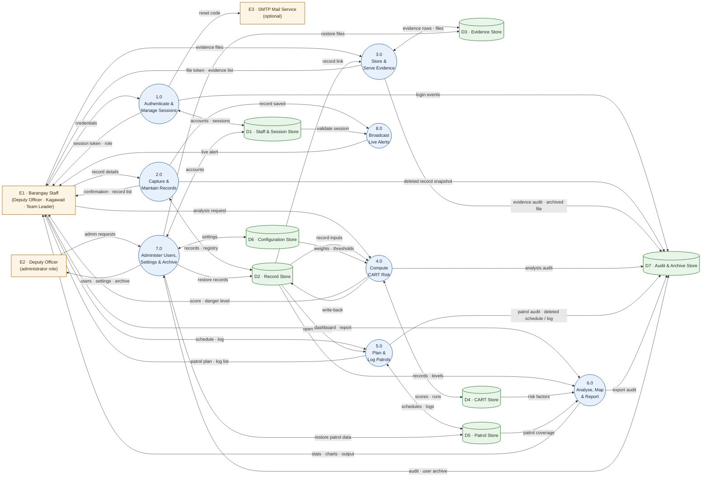
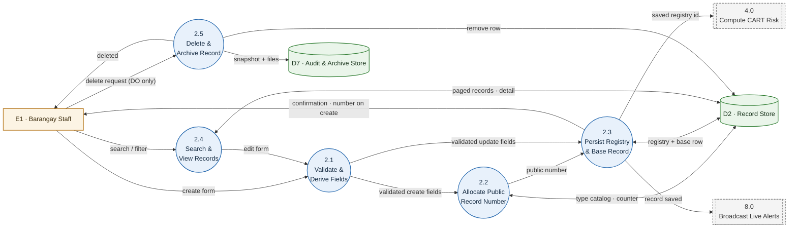
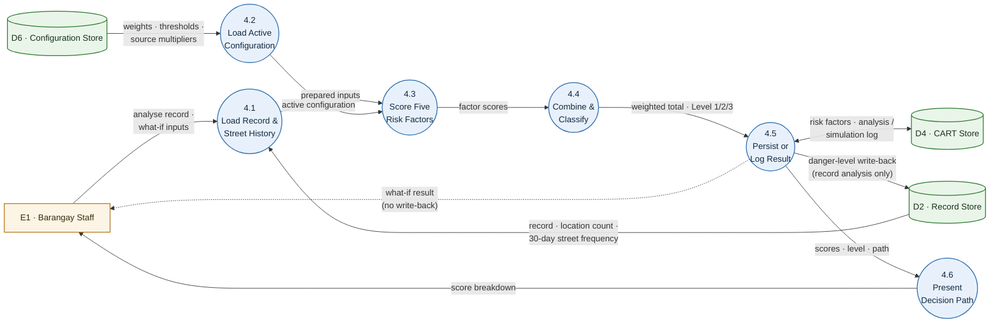

# Data Flow Diagrams — Level 0 and Level 1

Data flow diagrams for the **Barangay 179 Crime Intelligence and Patrol Decision
Support System**, derived from the running code (`backend/server.js`,
`backend/cart-engine.js`, `backend/archive.js`, `backend/recordTypes.js`) and the
current database (`database/schema.sql` + `database/migrations/`).

The Level 0 context diagram is a static SVG/PNG because its three role-specific
external entities need a wider manual layout than Mermaid produces cleanly. Levels
1 and 2 are Mermaid flowcharts: GitHub renders them inline, and each block can be
pasted into the [Mermaid Live Editor](https://mermaid.live) for export. Pre-exported
files are in [`diagrams/`](diagrams/) and linked with each diagram below.

> **Reading note.** `incidents` is a database **view** over `blotter_records` +
> `incident_records`, joined through `record_registry` (`server.js`, "Option A record
> routing helpers"). Throughout the app, the record identifier is `registry_id`, and
> that is the id used by `cart_risk_factors`, `incident_evidence` and audit rows.

---

## 1. Notation

| Symbol | Meaning |
|---|---|
| Rectangle | External entity — a person, role, or system outside the boundary |
| Circle (Levels 1–2) or rounded rectangle (Level 0) | Process — work the system performs |
| Open-ended cylinder | Data store — tables or files at rest |
| Solid arrow | Data flow |
| Dashed arrow | Out-of-band flow (delivery that happens outside the system) |

---

## 2. Level 0 — Context Diagram

The whole system is a single process. Its external entities are the three
authenticated staff roles, shown separately because each role sends and receives a
different subset of the system's data. The optional SMTP mail service is omitted
from this view for readability; it carries only the password-reset code.

**Figure 2.** Level 0 Context Diagram of the Barangay 179 Crime BI and Patrol
Decision Support System.

**Export:** [PNG](diagrams/dfd-level-0-context.png) · [SVG](diagrams/dfd-level-0-context.svg)

**Role flows**

- **Deputy Officer (Administrator)** — *sends:* login credentials; blotter /
  incident details; evidence; patrol schedules and logs; CART weights and
  thresholds; user accounts; settings; archive/restore selections; analysis,
  view, and report requests. *Receives:* session token; record confirmations and
  lists; risk scores and decision paths; dashboards, maps, and reports; patrol
  recommendations; restored records and audit trail; live alerts.
- **Team Leader** — *sends:* login credentials; blotter / incident details;
  evidence; patrol schedules and logs; analysis, view, and report requests.
  *Receives:* session token; record confirmations and lists; risk scores and
  decision paths; dashboards, maps, and reports; patrol recommendations; live
  alerts.
- **Kagawad** — *sends:* login credentials; record and patrol search criteria;
  what-if analysis inputs; analysis, view, and report requests. *Receives:*
  session token; read-only records and patrol data; risk scores and decision
  paths; dashboards, maps, and reports; live alerts.

**Control parameters.** Dashboard filters and map viewport are included under
"analysis / view / report requests". They select which already-authorized data is
displayed and are applied in the browser; they are not separate data stores or
record flows.

**Boundary decisions**

- **No citizen-facing interface.** Residents/complainants transact in person or on
  paper; a staff member transcribes their report. Citizens are therefore *not* an
  external entity on this diagram — adding one would imply a data flow the system
  does not have.
- **Map tiles are not a system flow.** Mapbox is called directly by the browser to
  render basemap tiles; no barangay data leaves the system through it.
- **Email is optional.** If `EMAIL_USER` is not configured, the reset flow still
  records the request but no mail is sent. The SMTP service is omitted from this
  role-specific view to keep the three actors readable; the password-reset code is
  the only flow that would cross to it.
- **Roles are not cosmetic.** Administrator-only actions (users, settings, archive,
  CART weights, audit) belong to the Deputy Officer; Kagawad is read-only for
  records and patrol data; Team Leader can create records, upload evidence, and
  maintain patrol schedules/logs. These restrictions are enforced in `server.js`,
  not just hidden in the UI.

---

## 3. Level 1 — Decomposition

Level 1 splits process 0 into the eight processes the code actually implements.
`E1` covers normal use by any authenticated role; `E2` is the same Deputy Officer
account acting in its **administrator** capacity, shown separately because those
flows (users, settings, archive, audit) are role-restricted. Login is drawn once
against `E1` to avoid duplicating the same flow for every role. The three Level 0
actors are therefore re-aggregated into `E1` here; the only internal split that
matters is normal use versus the Deputy Officer's administrator capacity (`E2`).

**Export:** [PNG](diagrams/dfd-level-1-decomposition.png) · [SVG](diagrams/dfd-level-1-decomposition.svg)

**Session checks are omitted from most processes.** Every route except the SSE
stream is wrapped in `authenticate` + `requireRole`, which re-queries `D1` on each
call. Drawing that arrow from all eight processes back to `D1` would obscure the
data movement the diagram is meant to show; process 1.0 owns the flow instead.

---

## 4. Level 2 — Decomposition

Two Level 1 processes carry enough internal branching to justify a Level 2. Child
numbering follows the parent (`2.1`, `2.2`, …). The double-bordered processes are
Level 1 processes outside the decomposition, shown only as interfaces.

### 4.1 Process 2.0 — Capture & Maintain Records

**Export:** [PNG](diagrams/dfd-level-2-records.png) · [SVG](diagrams/dfd-level-2-records.svg)

**Notes**

- Every create gets a public number, including drafts; drafts differ only in the
  relaxed respondent-required rule and in being excluded from scoring, dashboards
  and alerts.
- An update keeps the existing public number and record class. Changing a record from
  blotter to incident after creation is rejected, so `2.2` runs only on create.
- `2.3` writes the base table and `record_registry` in one transaction; the returned
  `registry_id` is the id used everywhere else.

### 4.2 Process 4.0 — Compute CART Risk

**Export:** [PNG](diagrams/dfd-level-2-cart.png) · [SVG](diagrams/dfd-level-2-cart.svg)

**Notes**

- `4.3` is not a plain weighted sum: the submitted subjective severity indication (High/Medium/Low) resets the
  **type** weight (30/20/10 %) and re-proportions the other four factors. The
  configured base weights apply to the other four and to non-typed paths.
- `4.4` multiplies the weighted total by the record **source** multiplier
  (`blotter` vs `incident`) before bucketing.
- The auto path (after save/edit) persists; the what-if path (`/api/cart/predict`)
  scores supplied inputs, logs a `simulation` row, and returns without writing
  `cart_risk_factors` or `danger_level`.
- Draft records are refused/cleared in `4.1`, which is why a draft never appears in
  the CART store.

---

## 5. Data dictionary

### 5.1 External entities

| ID | Entity | Description |
|---|---|---|
| E1 | Barangay Staff | Any authenticated role (Deputy Officer, Kagawad, Team Leader) using the system operationally: login, records, evidence, CART, patrols, dashboards and reports. |
| E2 | Deputy Officer | The Deputy Officer acting in the **administrator** role only: user management, settings/CART weights, archive/restore, audit logs and the gated location-coordinate setup. Operational flows for this same person are covered by E1. |
| E3 | SMTP Mail Service | Optional Nodemailer transport used only to deliver password-reset codes. |

### 5.2 Processes

| ID | Process | Responsibility | Main code / routes |
|---|---|---|---|
| 1.0 | Authenticate & Manage Sessions | Verify credentials, issue and expire session tokens, enforce lockout, handle password reset/change/logout. Runs the 5-minute idle-session sweep. | `/api/auth/*`, `authenticate`, `requireRole`, `user_sessions`, `login_attempts` |
| 2.0 | Capture & Maintain Records | Create, read, update and soft-delete blotter/incident records; allocate public record numbers; keep registry and base tables in step; draft handling. | `/api/incidents*`, `/api/record-types`, `record_registry`, `blotter_records`, `incident_records` |
| 3.0 | Store & Serve Evidence | Accept up to 5 image/video files, validate magic bytes, store paths, issue 60-second HMAC file tokens, serve gated `/uploads`. | `/api/incidents/:id/evidence`, `/api/uploads/*`, `incident_evidence` |
| 4.0 | Compute CART Risk | Apply the rule-based weighted model to a record or a set of records; write factor scores and danger level; log the run. | `/api/cart/*`, `cart-engine.js`, `cart_risk_factors`, `cart_analysis_log` |
| 5.0 | Plan & Log Patrols | Manage schedules and completed/partial patrol logs, compute area risk decay, summarise patrol needs from open incidents. | `/api/patrol-schedules`, `/api/patrol-logs`, `/api/patrol/*` |
| 6.0 | Analyse, Map & Report | Dashboard KPIs, charts, heatmaps/street hotspots, and monthly report preparation (CSV/print generated client-side). | `/api/dashboard/*`, `/api/heatmap/*`, `/api/reports/log-export` |
| 7.0 | Administer Users, Settings & Archive | User CRUD/deactivation, system and CART settings, archive browsing/restore, audit-log viewing, location coordinates. | `/api/users*`, `/api/settings*`, `/api/archive*`, `/api/audit-logs` |
| 8.0 | Broadcast Live Alerts | Push `new_incident` / `incident_updated` events to currently connected staff browsers over Server-Sent Events, using single-use 30-second tickets. | `/api/notifications/ticket`, `/api/notifications/stream` |

### 5.3 Data stores

| ID | Store | Physical tables / files |
|---|---|---|
| D1 | Staff & Session Store | `users`, `user_sessions`, `login_attempts`, `login_history`, `password_resets` |
| D2 | Record Store | `record_registry`, `blotter_records`, `incident_records`, `record_type_catalog`, `record_number_counters`; read-only `incidents` view |
| D3 | Evidence Store | `incident_evidence` + `uploads/` (`incident-evidence/`, `incident-photos/`, `archive/`) |
| D4 | CART Store | `cart_risk_factors`, `cart_analysis_log`, `cart_decision_rules` |
| D5 | Patrol Store | `patrol_schedules`, `patrol_logs`, `location_coordinates`, `area_risk_decay` |
| D6 | Configuration Store | `system_settings` (CART weights, source multipliers, thresholds, session timeout) |
| D7 | Audit & Archive Store | `audit_logs`, `archived_records` |

### 5.4 Selected flows

| From → To | Data |
|---|---|
| E1 → 1.0 | Username + password; forgot-password username/email |
| 1.0 → E1 | Bearer session token, role, expiry |
| 2.0 → E1 | Public record number (`BLT-…`/`INC-…`), saved record, paged list, validation errors |
| E1 → 3.0 | Multipart evidence (≤5 images/videos), evidence view request |
| 3.0 → E1 | Evidence metadata and short-lived `?ftoken=` URL for ``/`<video>` |
| 2.0 → 4.0 | Incident type, time, day, street, severity, 30-day street frequency |
| 4.0 → D2 | Computed danger level written back to the base table behind the registry id |
| 4.0 → E1 | Factor scores, total 0–100, Level 1/2/3, decision path |
| D2/D4/D5 → 6.0 | Aggregates for KPIs, charts, heatmap and reports |
| E2 ↔ 7.0 | User CRUD, settings, archive/restore requests and their results |
| 2.0 / 3.0 / 5.0 / 7.0 → D7 | Deleted-record, evidence, patrol and user snapshots (row + files) for later restore |
| 7.0 → D2/D3/D5 | Restored rows and files, original ids preserved |
| 2.0 → 8.0 | Record-saved event payload (create or update) |
| 8.0 → E1 | `text/event-stream` alert; best-effort only — no offline queue |

### 5.5 Level 2 — process 2.0 subprocesses

| ID | Subprocess | Responsibility |
|---|---|---|
| 2.1 | Validate & Derive Fields | Enforce the Joi schema and approved type list; derive `time_of_day`, `day_of_week`, `is_weekend`; compose the structured address and display names. |
| 2.2 | Allocate Public Record Number | Map form type to record class, resolve the type acronym from the catalog, bump the counter atomically, and format `{BLT\|INC}-{CODE}-{NNNN}`. |
| 2.3 | Persist Registry & Base Record | Insert or update the base row and `record_registry` in one transaction; return the `registry_id` used by every downstream table. |
| 2.4 | Search & View Records | Server-side paging, filtering, search and detail lookup over the `incidents` view; drafts are excluded unless requested. |
| 2.5 | Delete & Archive Record | Snapshot the row, its evidence rows and any files into D7, then remove the row. Restricted to the Deputy Officer. |

### 5.6 Level 2 — process 4.0 subprocesses

| ID | Subprocess | Responsibility |
|---|---|---|
| 4.1 | Load Record & Street History | Read the record fields, the street's incident count and its 30-day frequency; skip/clear drafts. What-if mode uses the supplied inputs instead. |
| 4.2 | Load Active Configuration | Load CART weights, danger thresholds and source multipliers from `system_settings`, falling back to documented defaults. |
| 4.3 | Score Five Risk Factors | Score time, day, type (severity-adaptive), location and frequency against the fixed score tables. |
| 4.4 | Combine & Classify | Weighted sum × blotter/incident source multiplier, then bucket into Level 1/2/3 at the configured thresholds. |
| 4.5 | Persist or Log Result | Upsert `cart_risk_factors`, write `danger_level` back to the base record, and log the analysis or simulation run. |
| 4.6 | Present Decision Path | Return factor scores, the 0–100 total, the level and a human-readable rule trace for the dashboard/detail view. |

---

## 6. Assumptions and scope notes

1. **Internal storage is logical, not one-table-per-store.** A store may span several
   physical tables that always change together; the mapping is in §5.3.
2. **Drafts are records too.** They live in D2 with `is_draft = 1`, are excluded from
   CART scoring, dashboards, alerts and list views.
3. **Deletion is never destructive.** `2.0`, `3.0`, `5.0` and `7.0` move the row
   snapshot and any files into D7, which is why D7 receives both audit and archive
   flows.
4. **CART is rule-based, not machine learning.** See `docs/CART_MODEL.md`. The
   "CART" name is retained from the project's terminology.
5. **The SSE alert channel is deliberately lossy.** Clients not connected when a
   record is saved miss that alert; there is no notification inbox table.
6. **Reports are composed client-side.** The backend supplies JSON and records an
   audit entry; CSV/print generation happens in `frontend/report.js`.

## 7. Exported files

| Diagram | Vector | Raster |
|---|---|---|
| Level 0 — context | [SVG](diagrams/dfd-level-0-context.svg) | [PNG](diagrams/dfd-level-0-context.png) |
| Level 1 — decomposition | [SVG](diagrams/dfd-level-1-decomposition.svg) | [PNG](diagrams/dfd-level-1-decomposition.png) |
| Level 2 — process 2.0 | [SVG](diagrams/dfd-level-2-records.svg) | [PNG](diagrams/dfd-level-2-records.png) |
| Level 2 — process 4.0 | [SVG](diagrams/dfd-level-2-cart.svg) | [PNG](diagrams/dfd-level-2-cart.png) |

PNGs are 2400 px wide on a white background; SVGs scale without loss in Word or
LaTeX. Re-export after editing a block by pasting it into the Mermaid Live Editor.
